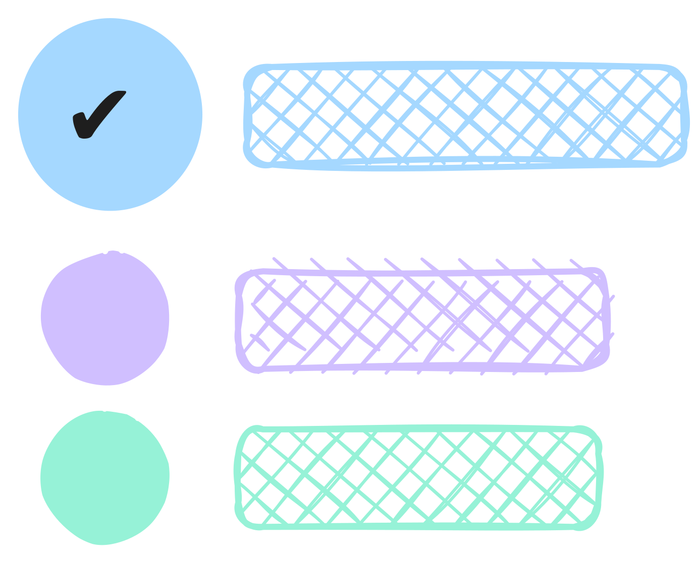

# LiteList



A demo to-do list app for [sorrymint](https://github.com/sorrymint) to learn backend as a service (BaaS).
It is a learning project, not a template for production use.

See [PROJECT_PLAN.md](./PROJECT_PLAN.md) for the architecture, current status, and next steps.

## AI Disclosure

This project was created with the help of AI tools.
I used this project not only to learn about BaaS, but also to learn how to work effectively with AI. I am learning to use AI tools to help me write code, documentation, and tests. I am also learning to use AI tools to help me understand and debug code.

## Quick start

Run Supabase commands to create local Supabase environment.

```bash
npm install # Install Project dependencies.
npx supabase start       # starts the local Supabase stack
npx supabase db reset    # applies migrations and seed data (deletes local data!)
npm run dev              # Starts the SvelteKit dev server
```

## Commands

| Command                                   | Purpose                                                                      |
| ----------------------------------------- | ---------------------------------------------------------------------------- |
| `npm run build`                           | Production build                                                             |
| `npm run check`                           | Svelte and TypeScript checks                                                 |
| `npm run test:unit -- --run`              | Unit tests                                                                   |
| `npm run test:db`                         | Database tests against the running local stack (access rules, invitations)   |
| `npm run test:e2e`                        | Playwright end-to-end tests                                                  |
| `npx supabase migration up`               | Apply new migrations without deleting local data                             |
| `npx supabase db reset`                   | Recreate the local database from migrations and seed                         |
| `npx supabase db push --remote --dry-run` | Show what would be pushed to the remote database without actually pushing it |
| `npx supabase db push --remote`           | Push changes to the remote database                                          |

> `test:db` needs `npx supabase start` and a seeded database. It cleans up its own lists, but each run leaves one extra
> test user until the next `db reset`.

To test the task retention boundary and scheduled purge against the seeded local database, run
`npx supabase db query --file supabase/tests/soft_delete.sql`.

### Password recovery

The local Supabase configuration uses `supabase/templates/recovery.html` for reset emails. Start
the app and local Supabase, request a reset from `/auth`, and open the email in Mailpit at
`http://127.0.0.1:54324`. The link can be opened in a different browser or device.

For hosted Supabase, configure the Reset password email template to match that file and add each
application's `/auth/reset-password` URL to the Auth redirect allowlist. Configure production SMTP
and review Auth's email rate limits in the Supabase dashboard; local configuration does not
automatically change hosted settings. The recovery link creates a normal authenticated session,
which the app signs out after the password changes.

## Database

Schema changes live in `supabase/migrations`. Add a new migration file for each change; do not edit applied ones.
Tests are in `supabase/tests`. Supabase Auth owns `auth.users`; a trigger creates a matching `public.profiles` row.

Tasks can be restored by any list member for 14 days after deletion. A PostgreSQL `pg_cron` job
purges expired tasks every minute, so physical removal can occur up to a minute after expiry.
Apply migrations with `npx supabase migration up` locally or the normal Supabase deployment
workflow; the database must support and enable `pg_cron`. Deleting a list remains permanent and
immediately deletes all of its tasks, including tasks in the trash.

## Web UI Implementation

The complete Svelte 5 UI is now implemented. See [IMPLEMENTATION.md](./IMPLEMENTATION.md) for detailed architecture documentation.
